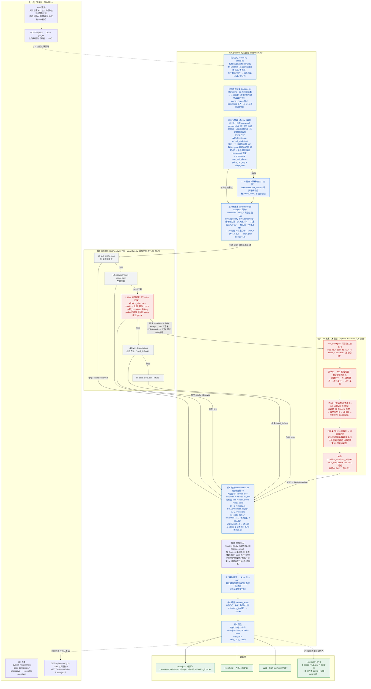

# 挂号推荐全流程图（矢量）

> 渲染说明：下图为 **Mermaid** 语法，在任何支持 Mermaid 的环境（GitHub / GitLab / VS Code / Typora / Obsidian）中会渲染为**矢量 SVG**，可无损缩放。
> 无需 Mermaid 渲染器时，可直接用浏览器打开同目录预渲染的 **`PIPELINE_FLOW.svg`**（由 mermaid-cli 12.0.0 实际渲染校验通过）。
> 需要重新导出：把代码块内容粘贴到 <https://mermaid.live>，右上角 Actions 即可导出。

## 1. 全流程图



## 2. 图例与读图要点

| 颜色 | 含义 |
|---|---|
| 蓝 | 管线主阶段（每次都执行） |
| 灰 | 号源缓存层（L1/L2/L4/L5，按序落空才下沉） |
| 红 | 实时采集（L3 及其内部 v2 五步；**仅 `--live` 时执行**，其余时候整块旁路） |
| 绿 | 出口（落盘 / 查询 / 回归门禁） |

- **实线** = 主流程与数据流；**虚线** = 辅助通道（web job 线程、SSE 日志推送、回归门禁纳入）。
- **两个关键分支点**：
  1. **LLM 双败兜底**（段3）：JSON 解析或结构校验（词汇/场景枚举/权重和）连续失败 → 用症状词表 `resolve_terms` + 场景基线权重顶上，标 `parse_failed`，管线继续。
  2. **§4.5 全未核实回退**（段6）：本批没有任何 verified 实时号源时，终排回退到**完整** Stage-1 静态榜（不是残集），全部条目显式标“号源未核实”——先验永不冒充实时。
- **号源 5 层的 miss 链**：L1→L2→L3→L4→L5 依次落空才下沉；**任何一层命中即返回**，返回的 `SlotInfo` 必带 `slot_source`（live / cache observed / cache level_default / stub / 未查询）与 `provenance`（来源文件、时间戳、TTL 校验）。

## 3. 分阶段说明

| 段 | 模块 | 输入 → 输出 | 失败路径 |
|---|---|---|---|
| 1 定位 | `locate.py` + `amap.py` | `--loc/--lat/--lon` → GCJ-02 坐标 + 锚点标注 | key 缺失/超时 → 锚点兜底（stub），报告标注 |
| 2 病例采集 | `dialogue.py` | 自由文本（≤3 轮）或 spec → `CaseSpec`（症状/年龄/性别/时效/偏好/代挂） | 轮次用尽 → 用当前已抽取 spec 继续 |
| 3 头推理（LLM 1/2） | `infer.py` + `llm_client.py` | spec + ≈14k 字上下文 → 权重向量(10, 和=1) + 目标科室(1~5 canonical) + scenario + 约束 | 校验/解析失败 → 带修正提示重试 1 次 → 再败 → lexicon 兜底 |
| 4 候选集 | `candidates.py` + `ranking/scripts/score_hospitals.py`（importlib 复用, 非重写） | 权重 + canonical → K=14~60 候选 + fetch_plan（≤12 个 (hid, dept)） | LLM 科室出界 → 走 lexicon 兜底链同构重算 |
| 5 号源解析 | `slots.py` | fetch_plan → SlotInfo × n（带 slot_source + provenance） | 五层落空终到 stub；`--live` 子进程失败 → 记日志, 继续下层 |
| 6 终排 | `recommend.py` | 静态分 + SlotInfo → final 列表（final_score / why / evidence） | 全批无 verified → §4.5 静态榜回退 + “号源未核实”标注 |
| 6b 终裁（LLM 2/2） | `finalize_llm.py` | deep 深核明细 + 患者摘要 → top3+医生+理由 | 校验失败/不可用 → 确定性 top3（两级排序）, 不阻断 |
| 7 模拟挂号 | `book.py` | top 推荐 → dry-run 挂号建议（医院/科室/医生/时段/费用） | 永不真实提交（450 家医院 capabilities.book=false） |
| 8 断言 | `validate_result` | 全量结果 → A/B/C/D 断言 pass/fail | 失败 → 非零退出码（见 docs/API.md），不改推荐内容 |
| 9 落盘 | `main.py` | 上述全部 → `result.json` + `report.md` + meta | web job 目录 `web_<ts>_<rand>`，自动纳入 `--check` |

**L3（v2 实时采集）五步**：状态复用决策 → 导航到目标科室页（444 列表 → H5 搜索 → 医院卡 → L1 科室页 → L2）→ 子 tab 枚举医生卡（点**卡体**进医生主页，六字段页）→ 日期条 30 天 × 时段行抓六字段记录 → 落 `condition_runs/` + raw XML 证据。全程零模型（纯 ADB + XML 文本匹配），启动时断言无 LLM 环境变量。

## 4. 关键契约与不变量

1. **LLM 唯一后端 = agentsvc; 全程恰好 2 次推理（段3 头推理 + 段6b 终裁, 均走同一后端）**（SSE `POST /v1/infer/stream`，model_id=`default`）。LLM 直出绝对权重向量（代码侧重归一化到行和=1）、目标科室必须**逐字**来自 `dept_index.json` 规范词表（代码校验，拒绝出界名）、scenario 限 5 值枚举。详见 `docs/LLM_CONTRACT.md`。
2. **slot_source 五值标注**：`live` / `cache(observed)` / `cache(observed expired)` / `cache(level_default 档位先验)` / `stub` / `未查询` —— 每层命中即打上对应标签，先验永不冒充实时。详见 `docs/SLOTS.md`。
3. **§4.5 回退**（`RANKING_SPEC` 契约）：全批无 verified → 回退**完整** Stage-1 静态榜 + 显式“号源未核实”，绝不把档位先验当实时事实呈现。
4. **B4 回归断言**（A/B/C/D）：静态 top12 ⊆ final.top_list、fallback top-20 与静态榜同序、静态最高分保留、被查询医院不得静默消失。`--check` = 5 cases × 4 = 20/20 全过才放行（含所有 web job）。
5. **安全底线**：不真实挂号/提交/支付；v2 采集**绝不点“确定”**；号源采集零模型（纯 ADB + UI XML）。
6. **全局单任务**（web）：adb 设备排他 + stdout 捕获是进程级状态 → 同时只允许 1 个 job，并发请求返回 409。
7. **CJK 安全通道**：live 条件经 UTF-8 JSON 文件（`--condition-file`）传入 v2，中文永不经过 argv。

## 5. 入口 / 出口速查

**入口**

| 通道 | 命令 |
|---|---|
| CLI demo | `python -X utf8 -m app.main --case demo:red_flag`（另有 chronic / peds / interactive） |
| CLI 结构化 | `python -X utf8 -m app.main --case spec-file:spec.json`（与 web 表单同 schema，见 `docs/API.md`） |
| CLI 实时号源 | 追加 `--live --live-slot-type expert --device 476cf991`（档位：expert/normal/specialty/不限） |
| Web | `python -X utf8 -m app.web --port 8765`（默认绑 0.0.0.0）→ 表单提交 |

**出口**

| 出口 | 内容 |
|---|---|
| `app/out/<job>/result.json` | 机读全量结果（meta/loc/spec/inference/stage1/slots/final/booking/checks，schema 见 `docs/API.md`） |
| `app/out/<job>/report.md` | 人读报告（10 章节：定位/病例/推理/候选/号源/终排/挂号/断言/…） |
| `slots/out/condition_runs/` | 仅 `--live`：v2 六字段记录 JSONL + run 汇总 + raw XML 证据 |
| Web SSE | `GET /api/stream?job=` 逐行实时日志；`GET /api/result?job=` 取 result.json；`GET /api/jobs` 历史任务 |

## 6. 复现与验证

```bat
python -X utf8 app\test_llm_chain.py            :: 离线自检（不依赖 LLM/设备）
python -X utf8 -m app.main --check              :: 回归门禁（20 断言全过）
python -X utf8 -m app.main --case demo:red_flag :: 单 case 全流程
python -X utf8 -m app.web --port 8765           :: web 实测端
```
